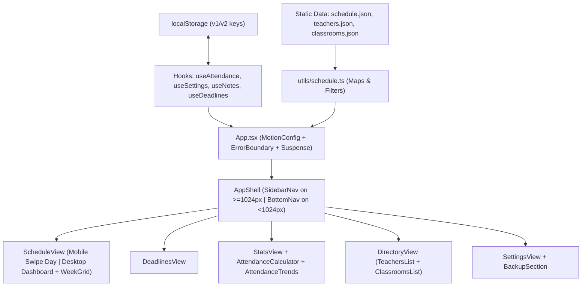

# Target Architecture — `uni-schedule 2.0`

## 1. Architectural Principles

1. **Pure Domain Core:** Date math, schedule filtering, attendance calculations, and backup serialization live in framework-agnostic `src/utils/` modules with unit tests.
2. **Single Source of Persistence Truth:** Custom hooks in `src/hooks/` own `localStorage` keys, schema validation, and safe error handling. Components never access `localStorage` directly.
3. **Adaptive Shell, Shared Feature Modules:** Mobile (`<1024px`) and Desktop (`>=1024px`) share the exact same hooks, data selectors, and feature views, differing only in layout composition (`AppShell`, `ScheduleView` Day vs Week Grid).
4. **Backward Compatibility First:** Legacy `uni_schedule_attendance_v1` and `uni_schedule_settings_v2` payloads load cleanly without migration loss.
5. **Code-Split Secondary Views:** `ScheduleView` loads eagerly on boot; `DeadlinesView`, `StatsView`, `DirectoryView`, and `SettingsView` are lazy-loaded to keep Time-to-Interactive fast.

---

## 2. Target Directory Structure & File Ownership Boundaries

```text
public/
  icons/
    apple-touch-icon.png         # 180x180 iOS home screen icon
    icon-192.png                 # 192x192 PWA icon
    icon-512.png                 # 512x512 PWA icon
    icon-maskable-512.png        # 512x512 maskable Android icon
    favicon.svg                  # Vector browser tab icon
  manifest.json                  # Complete PWA manifest
  sw.js                          # Service worker (or generated by vite-plugin-pwa)

src/
  types/
    index.ts                     # Domain types (Lesson, Teacher, Classroom, Attendance, Settings)
    notes.ts                     # LessonNote, DeadlineItem, Priority types
    backup.ts                    # UniScheduleBackupV2, BackupValidationResult

  data/                          # Immutable schedule dataset (preserve all existing IDs!)
    schedule.json
    teachers.json
    classrooms.json

  utils/                         # Pure functions — zero React imports
    cn.ts                        # clsx + tailwind-merge helper
    date.ts                      # Local ISO date helpers, week grid dates, parity helper
    schedule.ts                  # Lesson filter, Teacher/Classroom lookup maps, slot grid builder
    attendanceMath.ts            # Stats aggregation, target calculator, weekly trend series
    storage.ts                   # Safe localStorage read/write with QuotaExceededError guard
    backup.ts                    # Export builder, runtime schema validator, merge/replace engine

  lib/
    motion.ts                    # Framer Motion springs, variants, reduced-motion helpers

  hooks/                         # Stateful persistence & reactive browser APIs
    useAttendance.ts             # Owns `uni_schedule_attendance_v1`
    useSettings.ts               # Owns `uni_schedule_settings_v2`
    useNotes.ts                  # Owns `uni_schedule_notes_v1`
    useDeadlines.ts              # Owns `uni_schedule_deadlines_v1`
    useCurrentPair.ts            # Live pair, next pair, countdown, progress %
    useTheme.ts                  # Syncs settings.theme + prefers-color-scheme to DOM
    useMediaQuery.ts             # Breakpoint detection (desktop >= 1024px)
    useOnlineStatus.ts           # navigator.onLine + SW update prompt state

  components/
    ui/                          # Reusable Graphite Glass primitives
      GlassCard.tsx
      Badge.tsx
      SegmentedControl.tsx
      ModalDrawer.tsx
      EmptyState.tsx
      Toast.tsx
    layout/                      # Navigation & responsive shell
      AppShell.tsx               # Responsive wrapper (Desktop Sidebar vs Mobile BottomNav)
      SidebarNav.tsx             # Desktop >= 1024px navigation + profile + theme quick toggle
      BottomNav.tsx              # Mobile < 1024px glass tab bar
      OfflineBanner.tsx          # Offline / SW update banner
    schedule/                    # Schedule & Dashboard domain
      ScheduleView.tsx           # Orchestrates Mobile Day+Swipe vs Desktop Dashboard/WeekGrid
      LivePairHero.tsx           # "Зараз / Далі" card using currentLesson & nextLesson
      WeekStrip.tsx              # Interactive Mon–Fri strip + calendar jump
      WeekGrid.tsx               # Desktop 5-column timetable matrix (Mon–Fri × Slots 1–8)
      PairCard.tsx               # Accessible glass lesson card + attendance + note trigger
      LessonNotesDrawer.tsx      # Per-lesson notes & quick homework drawer
    deadlines/                   # Homework & Deadlines domain
      DeadlinesView.tsx          # Filterable deadlines list + creation modal
      DeadlineCard.tsx
      DeadlineFormModal.tsx
    stats/                       # Analytics domain
      StatsView.tsx              # Monthly / Semester overview + breakdowns
      AttendanceCalculator.tsx   # Goal threshold, safe skips left, recovery classes
      AttendanceTrends.tsx       # SVG weekly attendance trend chart
    teachers/                    # Teachers directory
      TeachersList.tsx           # Searchable teachers list with subject/lesson counts
    classrooms/                  # Classrooms directory
      ClassroomsList.tsx         # Searchable classrooms grouped/filtered by building
    directory/
      DirectoryView.tsx          # Combined Teachers + Classrooms tab view
    settings/                    # Configuration & Backup domain
      SettingsView.tsx           # Department, subgroup, elective, theme, goal, backup
      BackupSection.tsx          # Export JSON, Import preview modal (Merge / Replace)

  App.tsx                        # Top-level state wiring, MotionConfig, ErrorBoundary, Suspense
  main.tsx                       # Entry point + SW registration
  index.css                      # Graphite Glass CSS variables, base styles, reduced-motion
```

### Multi-Agent Ownership Boundaries

| Owner Role | Assigned Scope | Forbidden / Coordinate First |
|---|---|---|
| **Architect / Core Lead** | `src/types/*`, `src/utils/*`, `src/hooks/*`, `docs/*`, `tsconfig.json`, `package.json` | Do not break `uni_schedule_attendance_v1` or `uni_schedule_settings_v2` shapes |
| **Design & Motion Engineer** | `tailwind.config.js`, `src/index.css`, `src/lib/motion.ts`, `src/components/ui/*`, `src/components/layout/*` | Do not embed business/storage logic in UI primitives |
| **Schedule & Dashboard Engineer** | `src/components/schedule/*`, `src/components/directory/*`, `src/components/teachers/*`, `src/components/classrooms/*` | Must consume `utils/schedule.ts` & hooks; never mutate `schedule.json` IDs |
| **Productivity & Analytics Engineer** | `src/components/deadlines/*`, `src/components/stats/*`, `src/components/settings/*` | Must use `utils/attendanceMath.ts` & `utils/backup.ts` |
| **PWA & QA Engineer** | `public/*`, `index.html`, `vite.config.ts`, `tests/*` | Must verify all 9 viewports & `tsc --noEmit` + `vitest` + `vite build` |

---

## 3. Data Flow & Component Hierarchy



---

## 4. State Persistence & Backup Schemas

### 4.1 `uni_schedule_attendance_v1` (Preserved)
```ts
export type AttendanceStatus = 'present' | 'absent' | 'excused';

export interface AttendanceRecord {
  lessonId: string; // matches Lesson.id in schedule.json
  date: string;     // "YYYY-MM-DD" in local calendar time
  status: AttendanceStatus;
}
```
- **Invariant:** Uniquely keyed by `(lessonId, date)`. Clicking the already-active status removes the record; clicking a different status replaces it immutably.

### 4.2 `uni_schedule_settings_v2` (Preserved + Backward-Compatible Extensions)
```ts
export type ThemeMode = 'dark' | 'light' | 'system';

export interface UserSettings {
  // Preserved v1.x required fields
  subgroup: 1 | 2;
  department: 'sp' | 'oit' | 'rks' | 'rkt';
  electiveCourse: 'freelance' | 'management' | 'space' | 'both';
  // v2.0 optional extensions (defaulted on read)
  theme?: ThemeMode;              // default: 'dark'
  attendanceGoal?: number;        // default: 80 (percent, 50..100)
  showWeekends?: boolean;         // default: false
  semesterStartDate?: string;     // default: '2026-09-01'
  desktopScheduleMode?: 'day' | 'week'; // default: 'week'
}
```

### 4.3 `uni_schedule_notes_v1` (New)
```ts
export interface LessonNote {
  id: string;
  lessonId: string;
  date?: string;      // "YYYY-MM-DD" for date-specific note, omitted for general subject note
  content: string;
  updatedAt: string;  // ISO-8601
}
```

### 4.4 `uni_schedule_deadlines_v1` (New)
```ts
export type DeadlinePriority = 'normal' | 'high';

export interface DeadlineItem {
  id: string;
  title: string;
  subjectName?: string;
  lessonId?: string;
  dueDate: string;    // "YYYY-MM-DD"
  dueTime?: string;   // "HH:mm"
  priority: DeadlinePriority;
  completed: boolean;
  notes?: string;
  createdAt: string;  // ISO-8601
}
```

### 4.5 JSON Backup Schema (`UniScheduleBackupV2`)
```ts
export interface UniScheduleBackupV2 {
  schemaVersion: 2;
  exportedAt: string; // ISO-8601
  appVersion: string; // e.g. "2.0.0"
  data: {
    attendance: AttendanceRecord[];
    settings: UserSettings;
    notes: LessonNote[];
    deadlines: DeadlineItem[];
  };
}
```
- **Validation Rules (`utils/backup.ts`):**
  1. Reject non-object JSON or unsupported future `schemaVersion > 2`.
  2. Support `schemaVersion === 2` strictly validating each `AttendanceRecord`, `UserSettings`, `LessonNote`, and `DeadlineItem` entry (invalid entries are reported, never partially written on error).
  3. Support importing a legacy raw `AttendanceRecord[]` array (if user exported manually from `localStorage`) by wrapping it into a partial `attendance`-only import preview.
  4. Merge mode deduplicates attendance by `(lessonId, date)` (imported wins or newer `updatedAt` wins for notes/deadlines); Replace mode atomically overwrites all 4 keys after user confirmation.

---

## 5. Integration & Quality Rules

1. **Strict TypeScript:** Zero `any`, zero `@ts-ignore`, zero `.tsx` extensions in imports, and `tsc --noEmit` must pass before any merge.
2. **Lesson ID Stability:** Existing `lesson.id` values in `src/data/schedule.json` (`mon_3_freelance_lec`, `tue_1_soft_1`, etc.) **must never be renamed**, because `uni_schedule_attendance_v1` references them directly.
3. **Accessibility Baseline:**
   - Every icon-only button requires an explicit `aria-label`.
   - Navigation items use `aria-current="page"`; toggle/segmented buttons use `aria-pressed` or `role="radio"`/`aria-checked`.
   - Minimum `4.5:1` text contrast in both Dark Graphite Glass and Light Frosted Glass modes.
   - Pinch-to-zoom remains enabled (`user-scalable=yes` / no `maximum-scale=1.0`).
   - All motion respects `<MotionConfig reducedMotion="user">`.
4. **Performance & Bundle Budget:**
   - Lazy-load non-schedule views (`React.lazy`).
   - No heavy charting libraries (use custom accessible SVG for attendance trends).
   - Maintain initial JS payload <= 350 KB raw / <= 115 KB gzipped.
